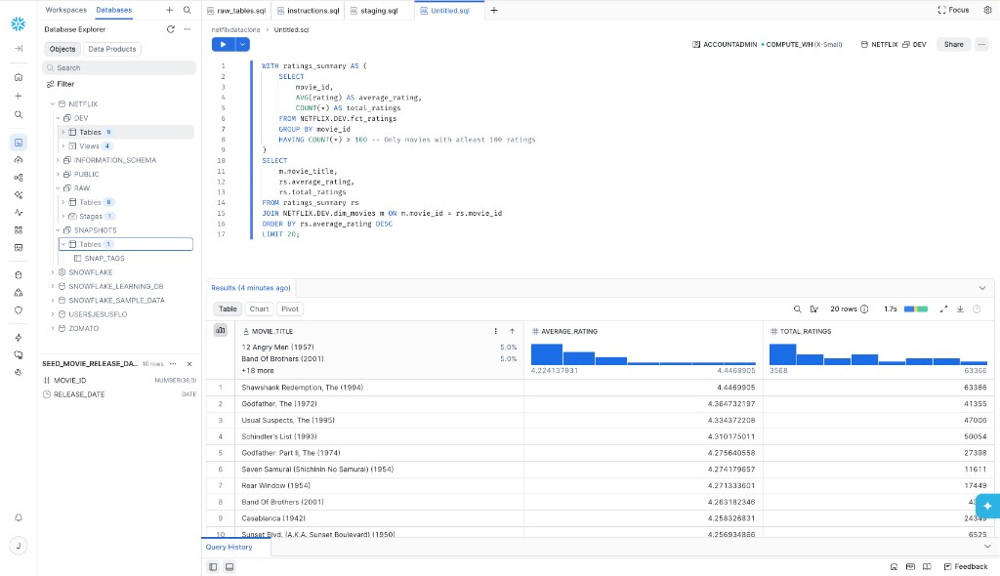
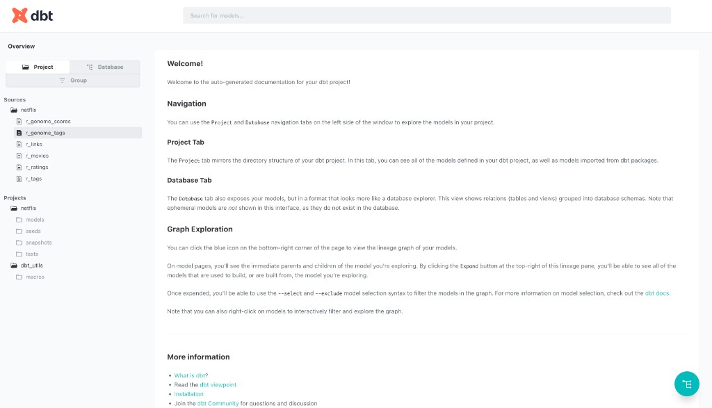
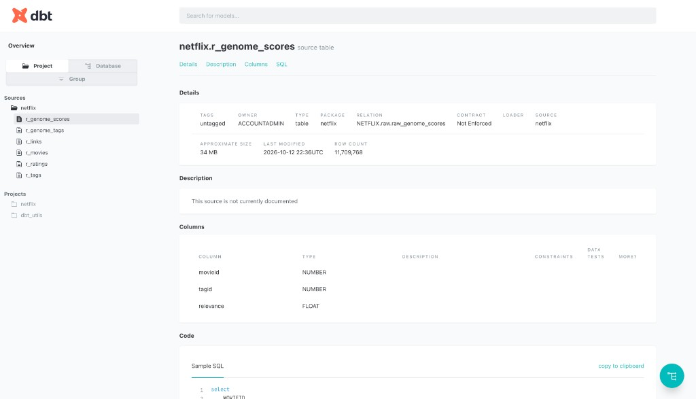
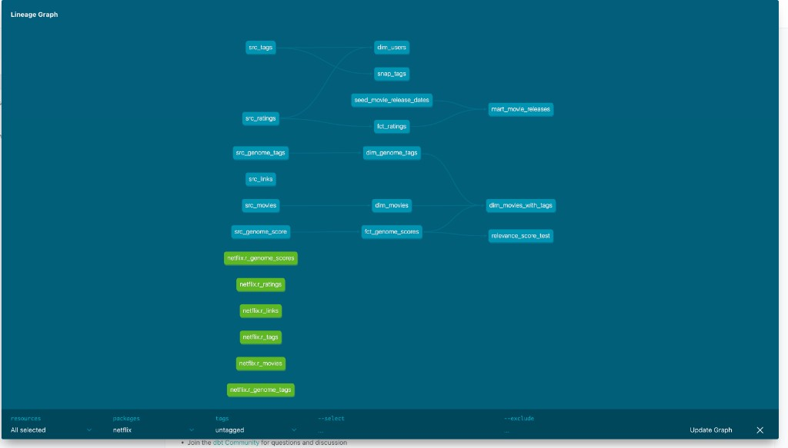

# Netflix Data Pipeline

This project loads movie data into S3, lands it in Snowflake, and models it with dbt. Staging views clean up the raw tables, then dimensions, facts, and one mart make the data easier to query. There is also a tag snapshot, a couple of tests, and a docs site so you can see how the models connect.

The warehouse is `NETFLIX`. Raw loads sit in `RAW`. dbt builds into `DEV`.

## Stack

- Amazon S3 for the raw files
- Snowflake for the warehouse
- dbt (Snowflake adapter) run with [uv](https://docs.astral.sh/uv/)
- Python 3.12
- [dbt_utils](https://hub.getdbt.com/dbt-labs/dbt_utils/latest/) 1.3.0, used for the snapshot surrogate key

## What gets built

Six raw tables are loaded from S3:

- `raw_movies`
- `raw_ratings`
- `raw_tags`
- `raw_genome_tags`
- `raw_genome_scores`
- `raw_links`

dbt reads those as sources and builds the models below.

| Model                  | What it does                                                                                                     |
| ---------------------- | ---------------------------------------------------------------------------------------------------------------- |
| `src_*`                | Renames columns to snake_case. Ratings and tags convert the unix timestamp with `TO_TIMESTAMP_LTZ`.              |
| `dim_movies`           | `TRIM` + `INITCAP` on the title. `SPLIT` turns the pipe-separated genre string into an array.                    |
| `dim_users`            | Distinct users from ratings and from tags, unioned so each person is one row.                                    |
| `dim_genome_tags`      | Trimmed, title-cased tag names.                                                                                  |
| `fct_ratings`          | One row per rating. Incremental: later runs only insert rows newer than `MAX(rating_timestamp)`.                 |
| `fct_genome_scores`    | `ROUND(relevance, 4)`. Rows with a relevance of 0 are dropped.                                                   |
| `dim_movies_with_tags` | Movies, genome tags, and relevance scores joined together. Ephemeral, so dbt does not store it as its own table. |
| `mart_movie_releases`  | Ratings left-joined to the release-date seed. Adds `release_info_available` (`known` or `unknown`).              |
| `snap_tags`            | History of user tags. Timestamp strategy on `tag_timestamp`.                                                     |

`fct_ratings` uses `{{ this }}` inside `is_incremental()` so it only looks at the table it already built. The snapshot uses `dbt_utils.generate_surrogate_key` on `user_id`, `movie_id`, and `tag`, because those three columns together identify a tag. Hard deletes are invalidated. Snapshots land in the `snapshots` schema.

`models/schema.yml` tests `not_null` on the main keys and a `relationships` test so every `fct_ratings.movie_id` exists in `dim_movies`. The macro `no_nulls_in_columns` loops over the columns on a model and fails if any of them are null. `tests/relevance_score_test.sql` runs that macro on `fct_genome_scores`.

dbt commands are run from `netflix/`.

## Analysis

`analyses/movie_analysis.sql` is not part of `dbt run`. Compile it, then run the SQL in a Snowflake worksheet. It averages ratings, keeps movies with more than 100 ratings, joins the title from `dim_movies`, and returns the top 20.

Shawshank Redemption comes out first (about 4.45, ~63k ratings), then The Godfather, The Usual Suspects, Schindler's List, and The Godfather Part II.



```bash
uv run dbt compile
```

Compiled SQL is written to `target/compiled/netflix/analyses/movie_analysis.sql`.

## Docs

`dbt docs generate` builds the site. `dbt docs serve` opens it at [http://localhost:8080](http://localhost:8080).

Sources are listed under `netflix`: `r_movies`, `r_ratings`, `r_tags`, `r_links`, `r_genome_tags`, and `r_genome_scores`. `r_genome_scores` is the large one, about 11.7 million rows.





The lineage graph is the easiest way to see the pipeline. Green nodes are the raw sources. Ratings feed `fct_ratings`, `dim_users`, and `mart_movie_releases`. Tags feed `snap_tags`. Genome scores and tags meet `dim_movies` in `dim_movies_with_tags`.



## Setup

### S3

1. Create a bucket and upload the raw files.
2. Create an IAM user, attach `AmazonS3FullAccess`, and create an access key.
3. Use that key when Snowflake reads the bucket.

### Snowflake

1. Create an account and a worksheet for this project.
2. Create the `NETFLIX` database and the `RAW` schema, and grant your role access.
3. Connect the bucket to Snowflake and load each file into its raw table.

### dbt

The project was created with `uv run dbt init`. Run the commands below from the `netflix/` folder, in this order. `uv run` uses the environment in this repo, so dbt does not need a separate virtualenv. Each later step reads something an earlier step already put in Snowflake or on disk.

`uv run dbt deps` installs the packages listed in `packages.yml`. The only package is `dbt_utils` 1.3.0. `snap_tags` calls `dbt_utils.generate_surrogate_key` to hash `user_id`, `movie_id`, and `tag` into one row key, so that package has to be installed first. Packages land in `dbt_packages/`.

`uv run dbt seed` loads `seeds/seed_movie_release_dates.csv` into the `DEV` schema as `seed_movie_release_dates`. `mart_movie_releases` left-joins that table to flag each rating as `known` or `unknown`, so the seed has to exist before the models run.

`uv run dbt run` builds everything under `models/`. Staging models (`src_*`) become views. Dimensions, facts, and `mart_movie_releases` become tables. `dim_movies_with_tags` is ephemeral, so it's compiled into the models that select from it and is not stored on its own. `fct_ratings` is incremental: the first run loads the full table, and later runs insert only rows newer than `MAX(rating_timestamp)`.

`uv run dbt snapshot` builds `snap_tags` in the `snapshots` schema. It reads `src_tags`, which `dbt run` just created, and keeps a history of tag changes with it's timestamp `tag_timestamp`. Hard deletes are invalidated. Snapshots stay on their own command because they track history separately from the current state models.

`uv run dbt test` checks the tables from `dbt run`. `models/schema.yml` asserts `not_null` on the main keys and a `relationships` test so every `fct_ratings.movie_id` exists in `dim_movies`. `tests/relevance_score_test.sql` runs the `no_nulls_in_columns` macro against `fct_genome_scores` and fails if any column on that model is null.

`uv run dbt compile` renders the Jinja in the project to SQL and writes it under `target/compiled/` without running it in Snowflake. That is how `analyses/movie_analysis.sql` becomes a query you can paste into a worksheet. The compiled file is `target/compiled/netflix/analyses/movie_analysis.sql`. See [Analysis](#analysis).

`uv run dbt docs generate` queries the warehouse and writes `target/manifest.json` and `target/catalog.json`, which describe the models, tests, sources, and column types. `uv run dbt docs serve` hosts that site at [http://localhost:8080](http://localhost:8080). Leave it running while you browse. See [Docs](#docs).
